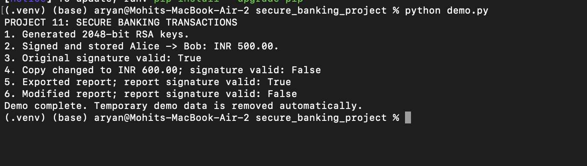

# Secure Banking Transaction using Digital Signatures

**Applied Cryptography — Project 11**

A small Python terminal application that generates RSA keys, digitally signs simulated transactions, stores them in SQLite, detects changes, and produces signed transaction reports. It does not transfer money or connect to a bank.

## Demo screenshot

This is a screenshot of the project running in the student's Terminal. A valid signature is accepted; changed transaction and report data are rejected.



## Start here

Install Python 3.10 or newer. Open a terminal inside this extracted project folder.

**macOS / Linux**

```sh
python3 -m venv .venv
source .venv/bin/activate
python -m pip install -r requirements.txt
python banking.py
```

**Windows (Command Prompt)**

```bat
py -m venv .venv
.venv\Scripts\activate
python -m pip install -r requirements.txt
python banking.py
```

The first installation needs internet access. After installation, the project runs offline. SQLite is included with Python; do not install it separately. If `Crypto` is missing, activate the same environment in which you installed the requirements.

## Quick demonstration

```sh
python demo.py
```

This automatically generates keys, signs a transaction, rejects a modified transaction, creates a signed report, and rejects a modified report. Its data lives in a temporary directory and is deleted afterward.

Expected behavior: the original transaction and report verify successfully (`True`). Changing the amount in a copy and editing the report cause verification to fail (`False`). The automatic demo deletes its temporary files when it finishes.

For your own saved transactions, use `python banking.py`.

## Menu and classroom demonstration

1. Choose **1** once to generate the private and public RSA keys.
2. Choose **2**. Enter sender `Alice`, receiver `Bob`, and amount `500.00`. Copy the printed transaction ID.
3. Choose **3** to see the saved record and its verification status.
4. Choose **4**, paste that ID, and see `VALID`.
5. Choose **5**, paste the same ID, and see the original is valid while a copy with INR 100 added is invalid. The original database record is preserved.
6. Choose **6** to export a report. Copy its full `.txt` path.
7. Choose **7**, paste that path, and see that the report is valid.
8. Open the `.txt` report in a text editor, add a word, and save. Repeat option **7**: the report is now invalid.
9. Choose **0** to exit.

Reports contain transaction amounts in integer paise: `50000` means INR 500.00. Times are explicitly stored in UTC. A new report gets a new filename.

## Files

| File | Purpose |
|---|---|
| `banking.py` | Main application, cryptography, database, and menu |
| `demo.py` | Automatic demonstration |
| `test_banking.py` | Automated tests |
| `requirements.txt` | The one external dependency |
| `PROJECT_REPORT.md` | Report draft explaining the work and limitations |
| `EXPLANATION_AND_VIVA.md` | Beginner explanation, code walkthrough, viva questions |
| `TEST_RESULTS.txt` | Recorded test output from this implementation |
| `SAMPLE_OUTPUT.txt` | Recorded automatic demonstration output |

When you run the main program, it creates `bank.db`, `keys/private.pem`, `keys/public.pem`, and later `reports/`. They are always placed beside `banking.py`, regardless of your terminal's starting directory. The download intentionally contains no private keys or personal transactions.

Keep your private key secret. Existing keys are never silently replaced: replacing them would prevent verification of old signatures. Reports have a companion `.sig` file; keep the two together. Verification uses the public key already in your project, not a key supplied by an untrusted report.

## Tests

```sh
python -m unittest -v
```

Tests run in temporary directories. They cover genuine signatures, each modified transaction field, wrong keys, modified signatures, stored database tampering, report tampering, invalid inputs, persistence, and key generation.

## Scope

This is a local cryptography demonstration with one signing identity, representing a single authorized operator. Account names are transaction details, not authenticated user identities. There is no login, balance management, payment processing, or network server. The report signature detects changes to an exported report; it does not prove that no database records were deleted before export.

The demonstration stores an unencrypted private key locally (with restricted file permissions where supported). Real banking requires stronger key protection, separate customer identities and trusted key registration, authorization, replay protection, and audited systems. Signatures provide integrity and authenticity relative to a trusted key; they do not hide transaction details.

## Submission checklist

- Read the explanation guide and run the manual demonstration yourself.
- Fill in your name, roll number, group members, course, and professor in the report draft.
- Follow any additional report format or submission rules supplied by your professor; the provided assignment image does not specify them.
- Include source files, requirements, the report, and test/demo output. Take screenshots of your own run if your professor asks for them.
- Follow your course's rules for acknowledging tools and assistance. Do not claim tests or experiments you have not run yourself.

## References

- [PyCryptodome RSA-PSS signing and verification](https://www.pycryptodome.org/src/signature/pkcs1_pss)
- [Python sqlite3 documentation](https://docs.python.org/3/library/sqlite3.html)
